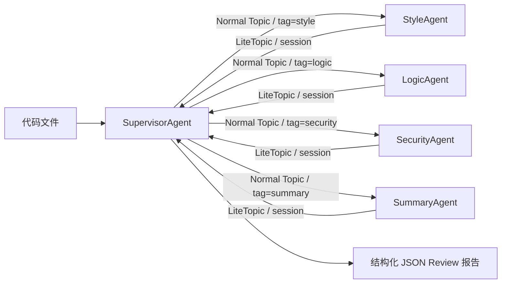

# RocketMQ 多智能体代码审查助手

常何小丫 · 2601210277

采用维护中的 apache/rocketmq-ai 的 rocketmq-a2a 1.0.10-SNAPSHOT（基线提交 47c7c6610c2829fdd6aefcde66afc956aba5d8a7）。Java 17。

## 架构与消息流



|资源|名称|配置|
|---|---|---|
|任务 Topic|rmqai-2601210277-review-task|Normal|
|回传父 Topic|rmqai-2601210277-review-reply|Lite/轻量主题|
|审查消费组|GID_2601210277_style / logic / security / summary（四个独立组，分别带完整前缀）|CLUSTERING，按同名 Tag 订阅|
|Supervisor 消费组|GID_2601210277_supervisor|LITE_SELECTIVE|
|会话 LiteTopic|2601210277-review-UUID|运行时订阅，单会话隔离|
|消息 Key|会话-role-UUID|包含学号，回传沿用请求 Key|

SDK 的 RocketMQUtil 创建 Producer 与 LitePushConsumer；普通任务消费者使用其底层 rocketmq-client-java API 在构造时设置 Tag 过滤，避免 SDK 通配订阅映射不可修改导致的运行异常。RocketMQRequest/RocketMQResponse 负责请求及回传封装，内部载荷使用 A2A JSON-RPC message/send 格式。应用支持本题需要的文本消息子集，不宣称实现完整 A2A 服务端协议。任务 Topic 使用 Tag 区分四类工作者，每类独立消费组；所有会话级回复通过 LiteTopic 路由。

Supervisor 在发送前注册 Future，三个维度并行等待，全部成功后交给 SummaryAgent；单请求 120 秒超时，失败不输出成功报告。回传使用会话和 requestId 双重关联，重复结果不会重复完成 Future。工作者保留最多 1000 条进程内响应缓存，重投可复用结果；缓存不跨重启，也不保证并发重投仅调用一次模型，生产部署需加入持久化幂等存储。

## 构建

仓库分支为 `course/2601210277-review-assistant`，工程目录为 `course-2601210277/review-assistant`。
仓库包含固定版本的 SDK 源码和已合并的 PR #12 修复，不依赖浮动下载的 SNAPSHOT。

```bash
git clone --branch course/2601210277-review-assistant --single-branch https://github.com/xych06688-a11y/rocketmq-ai.git
cd rocketmq-ai/course-2601210277/review-assistant
```

需要 Java 17、Maven 3.9.x 与 Bash。构建脚本自动识别 Git 仓库和课程 ZIP 两种目录布局，先安装 SDK，再构建应用并复制运行依赖：

```bash
export JAVA_HOME=/usr/lib/jvm/java-17-openjdk-amd64
bash build.sh
cp config.example.properties config.local.properties
chmod 600 config.local.properties
```

在 config.local.properties 填入实验实例 endpoint、namespace、RocketMQ 智能身份识别用户名和密码 与百炼模型配置。示例 endpoint/model 必须依据实验账号当前可用地域、模型和额度核对。文件已被 .gitignore 排除。不要将凭据上传到仓库或写入报告。

在两个终端运行：

```bash
bash run.sh worker config.local.properties
bash run.sh review config.local.properties sample-vulnerable.java.txt
```

仅将授权发送给模型的代码文件作为输入。本项目附带的示例为专门编写的练习文本，不执行其中代码。模型只负责分析，结果应由人复核。

## 证据与核验

运行日志包含 SEND/START/END/RECEIVE_REPLY、requestId、session 与真实消息 ID；results/ 写出模型原始维度结果和汇总。控制台用学号前缀 Key 查询，按时间范围检查任务 Normal Topic 与回传 LiteTopic，分别截图消息详情及轨迹。期望观察到 3 条初始任务、3 条维度回复、1 条汇总任务、1 条汇总回复。

本地协议单元测试仅验证 JSON 编解码和错误传播，不代表已完成云端实验。云端运行结果和控制台轨迹单独保存在实测证据目录。


## 历史天气实现与正式验收的区别

本目录的 WeatherMain 是早期自编天气实验，下面说明只描述该历史实现。
2026-11-17 后续正式验收已使用官方三个 Agent、百炼托管天气与行程应用，以及实时 MCP。
正式验收证据在课程材料的 `hosted-reproduction/`，不使用本目录的旧天气快照替代。

### 历史天气与行程协作

`course.WeatherMain` 复用相同的 rocketmq-a2a SDK 通信层。Supervisor 向
`WeatherAgentTask_2601210277` 发送城市及经纬度，WeatherAgent 获取实际天气数据并调用
百炼模型解释，回复到 `WorkerAgentResponse_2601210277` 的本次 LiteTopic。
Supervisor 再将天气结果发送至 `TravelAgentTask_2601210277`，TravelAgent 据此规划行程。
两个工作组分别为 `GID_2601210277_weather` 和 `GID_2601210277_travel`，会话组为
`GID_2601210277_weather_supervisor`。每条消息 Key 和动态 LiteTopic 均以学号开头。

```bash
java -cp 'target/classes:target/lib/*' course.WeatherMain worker config.local.properties
java -cp 'target/classes:target/lib/*' course.WeatherMain plan config.local.properties 北京 39.9042 116.4074
```

默认 WeatherTool 从 https://api.open-meteo.com/v1/forecast 获取天气。
本次 ECS 对该境外接口发生 TLS 握手超时，因此实测配置 `weather.snapshot=weather-snapshot.json`，
采用同一次实验中由本机 WSL 通过 HTTPS 实际获取后上传的原始天气快照。
快照包含来源 URL、获取时间和经纬度，超过六小时或坐标不一致会拒绝使用。
这是带来源的实测缓存，不是模拟天气；程序不会用模型猜测天气来掩盖请求失败。
附带的快照用于核验，过期后复现须重新获取，或移除该配置使用实时 API。

数据来源：Open-Meteo Weather Forecast API（https://open-meteo.com/en/docs），
按其 CC BY 4.0 数据许可保留来源。本课程非商业实验使用免费接口。
本目录早期实现采用自编 Java Agent。后续正式验收已另行创建百炼托管应用；最美天气改用高德实时天气，铁路采用 Tripmatch。

## 运行验收与排错

1. 在 RocketMQ 控制台按上表创建普通任务 Topic、轻量回传父 Topic 和五个消费组，类型须对应；endpoint 与 namespace 取自该实例，运行机器应能访问实例网络。
2. 私密配置填写有调用权限的 OpenAI 兼容模型 endpoint、model 和 API Key。示例模型名称来自历史实验，复现者需确认当前账号额度及模型权限。
3. 第一个终端出现 `WORKERS_READY student=2601210277` 后再执行第二个终端的 review 命令。
4. 成功时出现 `REVIEW_COMPLETE`，结果位于 `results/2601210277-review-*.json`。初始三路任务并行，随后一条汇总任务；应有四个请求与四个回复。
5. 用日志的 session、requestId 和消息 ID 查询控制台，分别保存 Normal 任务和 LiteTopic 回复轨迹。检查三路 START 早于任一路 END，summary 在三路结果齐备后开始。
6. endpoint 连通性、认证、Tag 订阅、LiteTopic 消费组类型及模型额度出错时，保留失败日志再修复配置，不将超时当作审查成功。模型 HTTP 错误不会产生成功报告。

`bash build.sh` 的单元测试不需要云凭据。完整端到端运行需要可用 RocketMQ LiteTopic 与模型接口；免费实验资源到期后须自行重新准备。五类 Agent 是逻辑角色，四个工作角色在同一个 JVM 中使用独立消费组运行。

## 模型与费用限制

实测模型为 `qwen3.8-flash`，OpenAI 兼容 HTTPS API，关闭思考模式，单次输出上限 4096 Token。
账号该模型已开启免费额度用完即停，课程密钥限制为该模型及临时 ECS 来源 IP。
API Key 与 RocketMQ 密码均只放在私密配置文件中，不纳入提交材料。
新密钥采用业务空间专属域名，请从自己的百炼控制台填写对应 endpoint。
结果文件只有收到所有必要 Agent 的真实回复后才写入成功标志。

## 开源来源

Apache RocketMQ AI SDK 源码：https://github.com/apache/rocketmq-ai
基线 commit：47c7c6610c2829fdd6aefcde66afc956aba5d8a7，模块 rocketmq-a2a，版本 1.0.10-SNAPSHOT。
依赖采用 Maven 下载，Apache 项目遵循 Apache License 2.0；本材料保留 SDK 来源与本地补丁。
通信使用 RocketMQUtil 构建客户端及 RocketMQRequest/Response 封装，正文为 A2A JSON-RPC
message/send 的文本子集。它不是完整的 A2A 服务端路由器，不支持流式回复或完整任务生命周期。

刷新天气缓存：`python3 refresh_weather.py --latitude 39.9042 --longitude 116.4074`。此脚本从真实 HTTPS API 获取数据，并写入当前获取时间；在能访问 API 的机器执行后，再将快照上传至运行机器。
